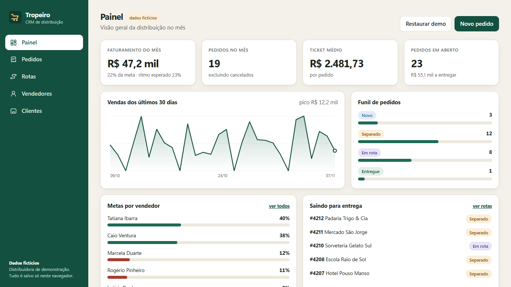
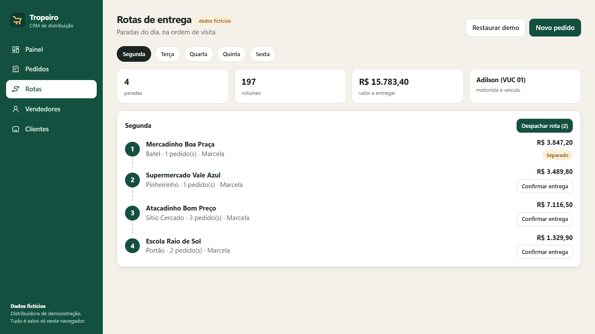
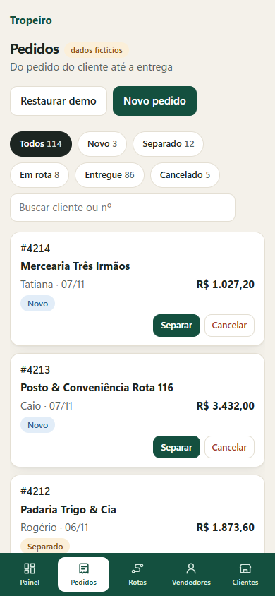
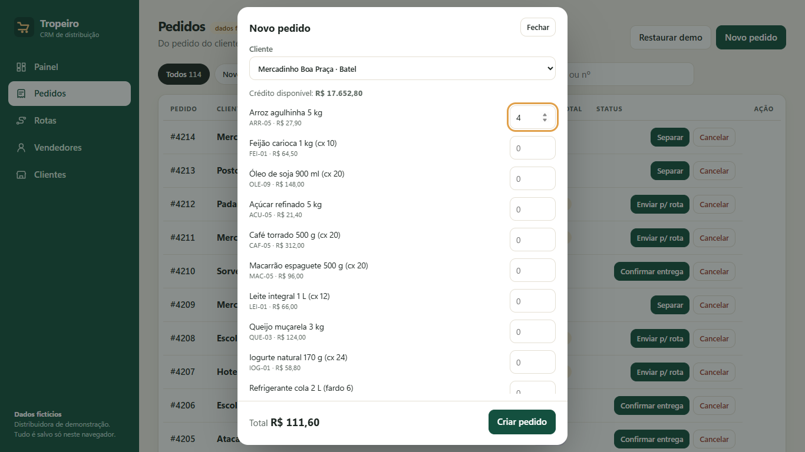

# Tropeiro CRM

A CRM for a fictional B2B food and supplies distributor: order pipeline, delivery routes by weekday, sales reps and monthly targets. Built with **Svelte 5** and Vite.

**Live demo:** https://alissonlittig.github.io/tropeiro-crm/

> All data is fictional and generated locally (seeded, deterministic). Nothing leaves the browser: state lives in `localStorage` and the "Restaurar demo" button resets it.



## What it does

- **Dashboard** – month revenue vs. target (with expected pace), average ticket, open orders, 30-day sales chart, order funnel and target progress per rep.
- **Orders** – filter by status, search, expand line items, move an order through *new → picked → on route → delivered* or cancel it. New orders are validated against the customer's credit limit minus their open balance.
- **Routes** – one route per weekday with stops in visit order, volumes, value, driver; dispatch all picked orders and confirm delivery stop by stop.
- **Reps & targets** – ranking by attainment, month projection and customer count.
- **Customers** – portfolio with route day and credit usage.

| Routes | Mobile (390px) | New order |
|---|---|---|
|  |  |  |

## Run it

```bash
npm install
npm run dev      # local dev server
npm test         # business-logic tests (node:test)
npm run build    # production build in dist/
```

## Structure

```
src/lib/logic.js         pure business rules (totals, targets, routes, credit check)
src/lib/data.js          seeded fictional dataset
src/lib/store.svelte.js  reactive state + localStorage persistence
src/views/               Dashboard, Orders, Routes, Reps, Clients, NewOrder
test/logic.test.js       unit tests for the rules above
```

CI (`.github/workflows/ci.yml`) installs, runs the tests, builds and deploys to GitHub Pages on every push to `main`.

## License

MIT
